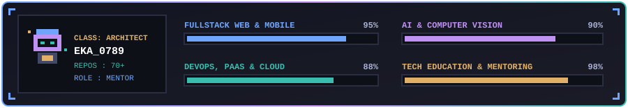
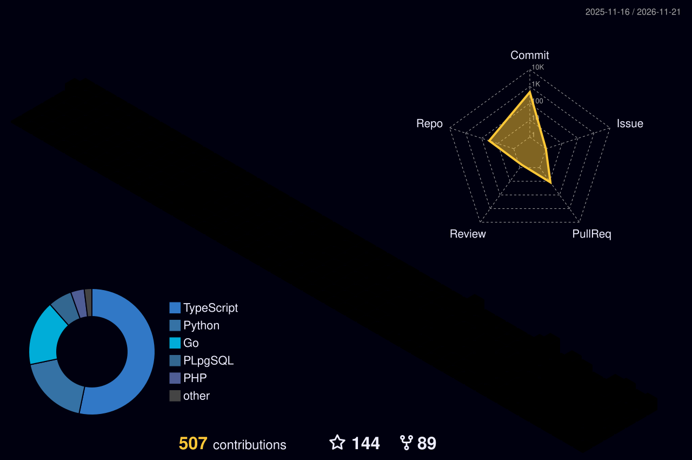
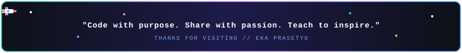

<!-- Custom Animated Pixel-Art Hero Banner -->
<p align="center">
  
</p>

<!-- Pixel-Font Animated Typing Subtitle -->
<p align="center">
  <a href="https://github.com/eka0789">
    
  </a>
</p>

<!-- Quick Action & Profile Badges -->
<p align="center">
  <a href="https://linkedin.com/in/eka-prasetyo">
    
  </a>
  <a href="mailto:eka0789@gmail.com">
    
  </a>
  <a href="https://github.com/eka0789?tab=followers">
    
  </a>
  
</p>

<p align="center">
  <a href="https://stardev.io/developers/eka0789">
    
  </a>
</p>

<p align="center">
  Welcome to my GitHub workspace! I'm a passionate engineer from <b>Indonesia 🇮🇩</b> focused on building modern web, mobile, DevOps, and AI-powered platforms. Beyond shipping products, I love empowering developers through workshops, mentoring, and open-source contributions.
</p>

<!-- Animated Pixel Divider -->
<p align="center">
  
</p>

<!-- Animated Pixel RPG Developer HUD -->
<p align="center">
  
</p>

## 🚀 About Me

```ts
const ekaPrasetyo = {
  location: "Indonesia 🇮🇩",
  roles: ["Fullstack Developer", "AI Builder", "Tech Educator", "Open Source Enthusiast"],
  focus: ["AI Platforms & Computer Vision", "Web & Mobile Apps", "Self-Hosted PaaS & Architecture"],
  currentlyWorkingWith: [
    "Python", "TypeScript", "Go", "Flutter", "React", "Nuxt", "Laravel", "FastAPI", "Docker"
  ],
  currentlyExploring: ["Autonomous AI Agents", "Industrial Computer Vision", "Cloud-Native Infra"],
  mentoring: "Coding Bootcamps & Tech Workshops 🎓",
  motto: "Code with purpose. Share with passion. Teach to inspire. 🚀"
};
```

<details>
  <summary><b>⚡ Click to expand full profile &amp; engineering highlights</b></summary>
  <br/>
  <ul>
    <li>💻 Experienced in <b>Fullstack Web, Mobile &amp; AI Platform Development</b> — end-to-end from architecture to production deployment</li>
    <li>👨‍🏫 Active in <b>teaching &amp; mentoring</b> programming, clean architecture, and modern software engineering</li>
    <li>📚 Passionate about <b>tech education, workflow automation, AI agents, and scalable systems</b></li>
    <li>📦 Built and maintained <b>70+ public and private repositories</b> across AI, mobile, ERP (Odoo), logistics, and DevOps</li>
    <li>💬 Ask me about: <b>web &amp; mobile engineering, AI systems, teaching tech, automation, and startups</b></li>
  </ul>
</details>

<p align="center">
  
</p>

## 🧰 Tech Stack &amp; Arsenal

<p align="center">
  <a href="https://skillicons.dev">
    
  </a>
</p>

<details>
  <summary><b>🛠️ View Categorized Tech Stack Matrix</b></summary>
  <br/>

| Category | Technologies |
| :--- | :--- |
| **Frontend &amp; Mobile** |        |
| **Backend &amp; ERP** |       |
| **Database &amp; Cloud** |     |
| **DevOps &amp; Infra** |     |

</details>

<p align="center">
  
</p>

## 📌 Latest Featured Projects

<table>
  <tr>
    <td width="50%" valign="top">
      <p align="center"><code>[ COMPUTER VISION // AI ]</code></p>
      <h3 align="center">👁️ IndustrialVision AI Platform</h3>
      <p align="center">
        Computer-vision visual inspection platform for manufacturing &amp; QC—integrating image testing, AI model management, operator workflows, and evidence logging.
      </p>
      <p align="center">
        
        
      </p>
      <p align="center">
        <a href="https://github.com/eka0789/industrialvision-ai-platform"><b>▶ Explore Repository →</b></a>
      </p>
    </td>
    <td width="50%" valign="top">
      <p align="center"><code>[ MOBILE // AI ASSISTANT ]</code></p>
      <h3 align="center">🎙️ NARA &amp; NARA Voice</h3>
      <p align="center">
        Offline-first hybrid AI companion app (tasks, notes, habits, bilingual ID/EN) paired with a Universal AI Voice Assistant for Android.
      </p>
      <p align="center">
        
        
      </p>
      <p align="center">
        <a href="https://github.com/eka0789/NARA"><b>▶ NARA App</b></a> &nbsp;·&nbsp; <a href="https://github.com/eka0789/nara-voice"><b>▶ NARA Voice</b></a>
      </p>
    </td>
  </tr>
  <tr>
    <td width="50%" valign="top">
      <p align="center"><code>[ AI AGENTS // WORKSPACE ]</code></p>
      <h3 align="center">🤖 DevFlow AI</h3>
      <p align="center">
        AI engineering workspace featuring planning agents, agile scrum workflows, GitHub integration, and autonomous AI code execution.
      </p>
      <p align="center">
        
        
      </p>
      <p align="center">
        <a href="https://github.com/eka0789/devflow-ai"><b>▶ Explore Repository →</b></a>
      </p>
    </td>
    <td width="50%" valign="top">
      <p align="center"><code>[ LOGISTICS OS // ENTERPRISE ]</code></p>
      <h3 align="center">🚚 Angkut — Logistics OS</h3>
      <p align="center">
        Intelligent Logistics Operating System built for Indonesian businesses with high-performance Go backend and modern Nuxt 4 frontend.
      </p>
      <p align="center">
        
        
      </p>
      <p align="center">
        <a href="https://github.com/eka0789/angkut"><b>▶ Explore Repository →</b></a>
      </p>
    </td>
  </tr>
  <tr>
    <td width="50%" valign="top">
      <p align="center"><code>[ DEVOPS // SELF-HOSTED PAAS ]</code></p>
      <h3 align="center">🚀 LocalDeploy</h3>
      <p align="center">
        Self-hosted application hosting platform with Git deploys, auto runtime detection, Docker, Traefik + SSL, Cloudflare Tunnel, and preview deploys.
      </p>
      <p align="center">
        
        
        
      </p>
      <p align="center">
        <a href="https://github.com/eka0789/localdeploy"><b>▶ Explore Repository →</b></a>
      </p>
    </td>
    <td width="50%" valign="top">
      <p align="center"><code>[ DEVELOPER TOOLS // DIRECTORY ]</code></p>
      <h3 align="center">📚 AllTools — Developer Dictionary</h3>
      <p align="center">
        Search and discover 800+ curated developer tools, resources, and AI services from one clean, fast interface.
      </p>
      <p align="center">
        
        
      </p>
      <p align="center">
        <a href="https://github.com/eka0789/alltools"><b>▶ Explore Repository →</b></a>
      </p>
    </td>
  </tr>
</table>

<p align="center">
  
</p>

## 🐍 Contribution Snake

<p align="center">
  <picture>
    <source media="(prefers-color-scheme: dark)" srcset="https://raw.githubusercontent.com/eka0789/eka0789/output/github-contribution-grid-snake-dark.svg" />
    <source media="(prefers-color-scheme: light)" srcset="https://raw.githubusercontent.com/eka0789/eka0789/output/github-contribution-grid-snake.svg" />
    
  </picture>
</p>

## 📊 GitHub Analytics &amp; 3D Pixel Activity

<p align="center">
  
  
</p>

<p align="center">
  
</p>

<details open>
  <summary><b>🧊 3D Isometric Pixel Contribution Calendar</b></summary>
  <br/>
  <p align="center">
    <picture>
      <source media="(prefers-color-scheme: dark)" srcset="https://raw.githubusercontent.com/eka0789/eka0789/output/profile-night-rainbow.svg" />
      <source media="(prefers-color-scheme: light)" srcset="https://raw.githubusercontent.com/eka0789/eka0789/output/profile-green.svg" />
      
    </picture>
  </p>
</details>

<details>
  <summary><b>📈 Click to view Live Contribution Activity Graph</b></summary>
  <br/>
  <p align="center">
    
  </p>
</details>

<p align="center">
  
</p>

## 📺 Content, Teaching &amp; Mentoring

| Area | Highlights |
| :--- | :--- |
| 🎓 **Coding Bootcamp Mentor** | Guiding aspiring developers in fullstack web, mobile development, and industry best practices |
| 📦 **70+ Repositories** | Active builder across AI platforms, self-hosted DevOps tools, mobile apps, and open-source projects |
| 💼 **Professional Network** | Connect &amp; read my updates on [LinkedIn](https://linkedin.com/in/eka-prasetyo) |

## ☕ Let's Connect!

<p align="center">
  Have an exciting project, workshop invitation, or just want to talk about <b>web &amp; mobile development, AI systems, tech education, automation, or startups</b>? Feel free to reach out!
</p>

<p align="center">
  <a href="mailto:eka0789@gmail.com">
    
  </a>
  <a href="https://linkedin.com/in/eka-prasetyo">
    
  </a>
</p>

<!-- Custom Animated Pixel-Art Footer -->
<p align="center">
  
</p>
